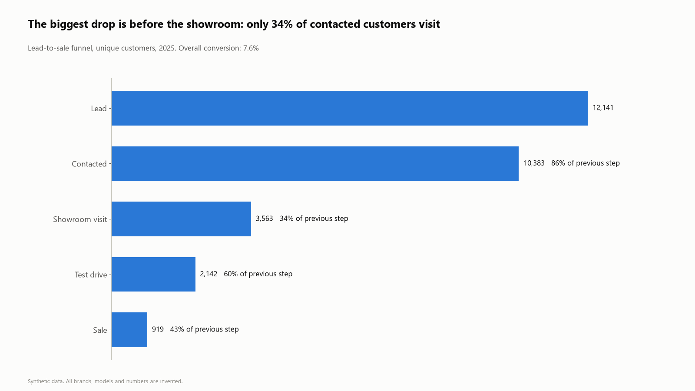
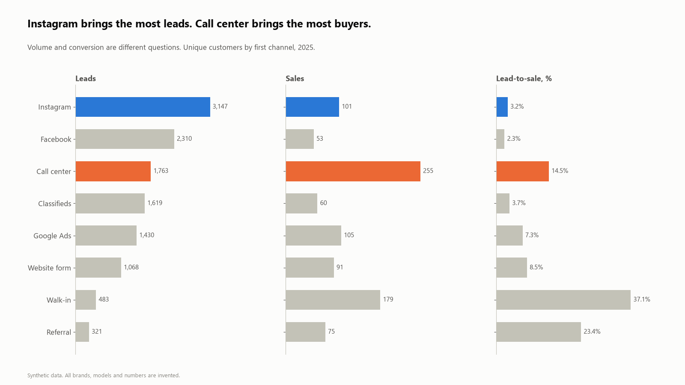
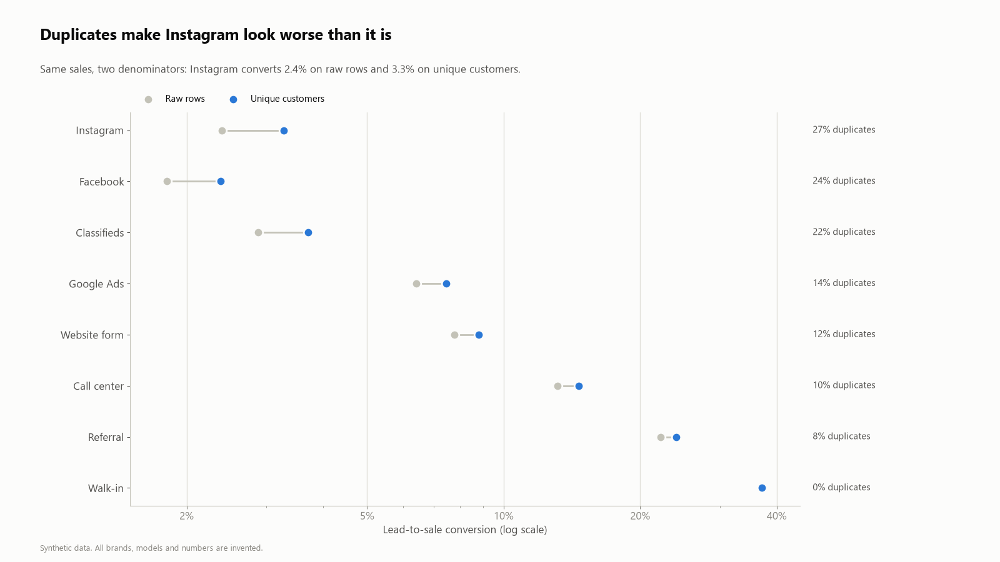
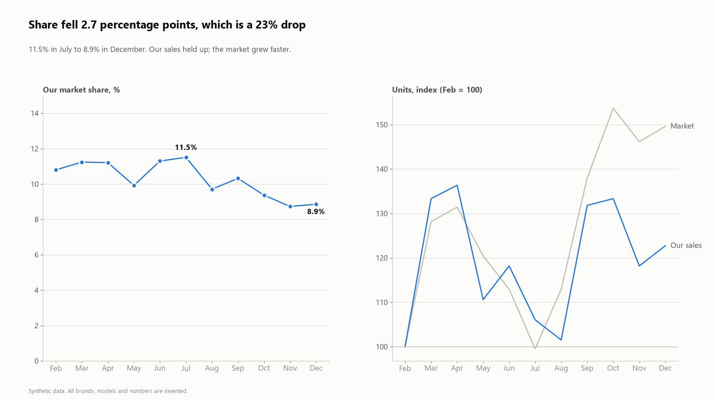
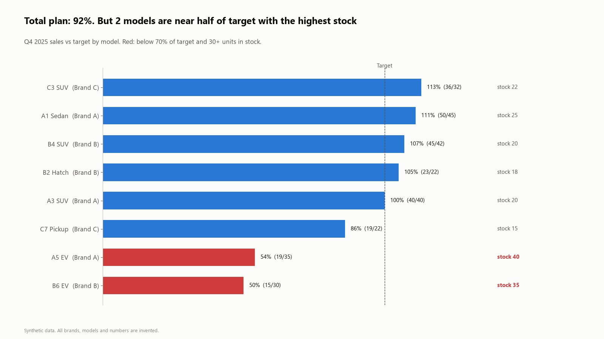

# Car Dealer Funnel Analytics

Lead-to-sale analysis for a car dealer group: where customers drop out, which channels bring buyers (not just leads), how duplicates distort conversion, why market share can fall while sales hold up, and which models a "92% of plan" total is hiding.

It mirrors the questions I answer every week as a marketing and sales analyst in automotive retail, **built on synthetic data**. All brands, models and numbers are invented; nothing comes from a real company.

**Stack:** SQL (SQLite, window functions, CTEs) · Python (pandas, NumPy) · matplotlib

---

## 1. Where are customers lost?



86% of leads are contacted, but only 34% of contacted customers come to the showroom. That step, not the test drive or the sale, is where most of the funnel is lost. → [`sql/02_funnel.sql`](sql/02_funnel.sql)

## 2. Volume and conversion are different questions



Instagram brings the most leads (3,147) but converts at 3.2%. The call center brings fewer leads and the most sales (255). Ranking channels by leads alone would put the best channel in third place. → [`sql/03_channel_performance.sql`](sql/03_channel_performance.sql)

## 3. Duplicates change the denominator



The same person often writes two or three times. Counted as rows, 27% of Instagram leads are repeats, and its conversion looks like 2.4% instead of 3.3%. Deduplication uses `ROW_NUMBER()` over customer and brand, keeping the first inquiry. → [`sql/01_deduplicated_leads.sql`](sql/01_deduplicated_leads.sql), [`sql/04_duplicate_effect.sql`](sql/04_duplicate_effect.sql)

## 4. Percentage points vs percent



Share went from 11.5% to 8.9%. That is **2.7 percentage points**, or a **23% drop**. Both are correct and they tell very different stories, so the query returns both. The right panel shows why: our sales grew, the market grew faster. → [`sql/05_market_share.sql`](sql/05_market_share.sql)

## 5. A total can hide a problem



Q4 plan is 92% complete overall. Two EV models are at about half of target and hold the most stock. The total looks fine; the model view shows where action is needed. → [`sql/06_stock_vs_target.sql`](sql/06_stock_vs_target.sql)

---

## Run it

```bash
pip install -r requirements.txt
python src/generate_data.py   # builds data/*.csv and data/dealer.db (fixed seed, same result every time)
python src/analyze.py         # runs sql/*.sql, writes outputs/*.csv and images/*.png
```

## Project structure

```
data/      synthetic leads, market totals, stock (CSV + SQLite)
sql/       one query per question, numbered in reading order
src/       generate_data.py, analyze.py
outputs/   query results as CSV
images/    charts used in this README
```

## Data model

| Table | Grain | Key columns |
|---|---|---|
| `leads` | one inquiry (duplicates included) | customer_id, created_at, channel, brand, model, contacted, visited, test_drive, sold, sale_date |
| `market` | month | market_units |
| `stock` | model | q4_target, stock_units |

## Notes and limits

- January is excluded from market share: the data starts in January, so sales from December leads are missing.
- Each customer is attributed to the channel of their first inquiry (first-touch). Other attribution rules would move some sales between channels.
- Funnel probabilities per channel are set in `generate_data.py`, so the patterns are designed, not discovered. The point of the project is the method and the queries.
